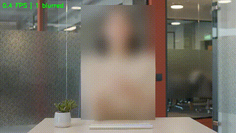

# Privacy Blur with YOLO

  

Real-time privacy blur for video. A pretrained YOLO11n model finds people, phones and laptops, each detected region is blurred, and a CPU benchmark compares YOLO at two input sizes, an ONNX export and a classic OpenCV Haar baseline.



## Features

- Webcam or video-file input, with a live FPS counter
- Blurs people, cell phones and laptops (class ids read from the model's own class names)
- Blur strength scales with the box size, so it looks the same at any resolution or distance
- Boxes are kept for 5 frames after a missed detection, which removes flicker
- Optional output to an `.mp4` file
- Reproducible CPU benchmark (warm-up, mean, 95th percentile, FPS) written to `results/results.md`
- ONNX export for a different inference path

## How it works

```
frame -> YOLO11n detector -> boxes -> merge with remembered boxes -> Gaussian blur per box -> show / save
```

1. OpenCV reads one frame.
2. The detector returns boxes `(x1, y1, x2, y2)` for the target classes.
3. `update()` keeps a box that was missed for up to 5 frames, matching boxes by overlap (IoU).
4. `blur_box()` blurs each rectangle with a Gaussian filter. The kernel is a fraction of the box's longer side (`--strength`) and the rectangle is clipped to the image edges.

## Results

Measured on an Intel Core i7-8665U (8 threads), Ubuntu, Python 3.12, OpenCV 4.14, using a short stock clip (960 px wide): 242 frames after a 10-frame warm-up, single run per row.

| Detector | Mean ms/frame | 95th percentile ms | FPS | Avg boxes/frame |
| --- | --- | --- | --- | --- |
| YOLO11n PyTorch, imgsz 640 | 66.6 | 93.7 | 15.0 | 1.00 |
| YOLO11n PyTorch, imgsz 320 | 29.1 | 39.9 | 34.4 | 1.00 |
| YOLO11n ONNX Runtime, imgsz 320 | 25.3 | 27.3 | 39.5 | 1.00 |
| Haar face detector (baseline) | 306.1 | 337.8 | 3.3 | 1.40 |

The YOLO rows detect person, laptop and cell phone; the Haar row detects frontal faces only, so compare speed across rows, not the box counts. Times include only `detect()`, not drawing or display.

Lowering the input size from 640 to 320 made YOLO11n about 2.3 times faster (15.0 to 34.4 FPS), and the ONNX Runtime export was a further 13 percent faster per frame (25.3 ms) with a tighter 95th percentile (27.3 ms against 39.9 ms). The Haar baseline was the slowest at 3.3 FPS, probably because it scans the full 960 px frame at many scales. The clip shows one person, so these numbers say nothing about how well phones are detected at each size. I did not measure detection accuracy.

The clip is not included in this repository. It is a free-licence stock video of a woman talking, downloaded from a free stock-video website. To recreate the benchmark, use any similar clip: save it as `data/women_talking.mp4` and run:

```bash
ffmpeg -y -i data/women_talking.mp4 -t 12 -vf scale=960:-2 -an data/short.mp4
```

## Quick start (Ubuntu)

```bash
git clone https://github.com/Shanza-Fatima/Privacy-blur-with-YOLO.git
cd Privacy-blur-with-YOLO
python3 -m venv .venv && source .venv/bin/activate
pip install torch torchvision --index-url https://download.pytorch.org/whl/cpu
pip install -r requirements.txt
python live_blur.py
```

Press `q` to quit. The first run downloads `yolo11n.pt` (about 5 MB).

## Usage

```bash
python live_blur.py                                        # webcam
python live_blur.py --source data/short.mp4 --no-show --save assets/demo.mp4   # video file in, blurred video out
python live_blur.py --imgsz 320                            # faster, misses small objects more
python record_clip.py --seconds 20                         # record a clip with your webcam
python export_onnx.py                                      # create yolo11n.onnx
python benchmark.py                                        # benchmark on data/short.mp4, writes results/results.md
```

| Option | Default | Meaning |
| --- | --- | --- |
| `--source` | `0` | Camera number or video path |
| `--weights` | `yolo11n.pt` | `.pt` or `.onnx` model |
| `--imgsz` | `640` | Size the model sees. 320 is faster, 640 finds small objects better |
| `--conf` | `0.25` | Minimum detection confidence |
| `--strength` | `0.35` | Blur strength as a fraction of the box size |
| `--save` | none | Write the result to this `.mp4` (the folder must exist) |
| `--save-fps` | `15` | Speed of the saved video |
| `--no-show` | off | Do not open a window |

## Make the demo GIF

```bash
mkdir -p assets
python live_blur.py --source data/short.mp4 --no-show --save assets/demo.mp4
ffmpeg -y -i assets/demo.mp4 -vf "fps=10,scale=480:-1:flags=lanczos" assets/demo.gif
```

## Project structure

```
blur_utils.py     blur_box(): clipped Gaussian blur of one rectangle
detectors.py      YoloDetector and HaarFaceDetector with the same detect(frame) interface
live_blur.py      main program: video -> detect -> blur -> show / save
record_clip.py    records a test clip with the webcam
export_onnx.py    exports the model to ONNX
benchmark.py      times each detector and writes results/results.md
detect.py         quick check that both detectors run
results/          benchmark output
assets/           demo GIF
```

## Design decisions

- **Same interface for every detector.** Each detector has `detect(frame)` returning boxes, so the benchmark treats YOLO and Haar identically.
- **Pretrained model, no training.** The goal is a working pipeline and a fair speed measurement, not a new model.
- **Warm-up before timing.** The first frames are slower because of model loading, so they are excluded.
- **95th percentile, not only the mean.** It shows the slow frames that make video stutter.
- **Relative blur strength.** A fixed kernel looked strong on a webcam and weak on a high-resolution video, so the kernel now follows the box size.

## Limitations

- Pretrained COCO model: it knows 80 object types and nothing else.
- It blurs the whole person box, not only the face.
- Small objects such as phones are missed more often at `--imgsz 320`.
- The Haar baseline finds frontal faces only.
- Tested on one laptop CPU and one short clip. Speed only, no accuracy evaluation.

## Future work

- Blur only the head region, or use a face-specific detector
- Evaluate accuracy on a small labelled set
- Track objects across frames instead of overlap matching
- Compare against a larger model (`yolo11s`) for small-object recall

## Credits

Built with [OpenCV](https://opencv.org/) and [Ultralytics YOLO11](https://docs.ultralytics.com/). I wrote and tested the code myself with AI guidance and the official documentation.
